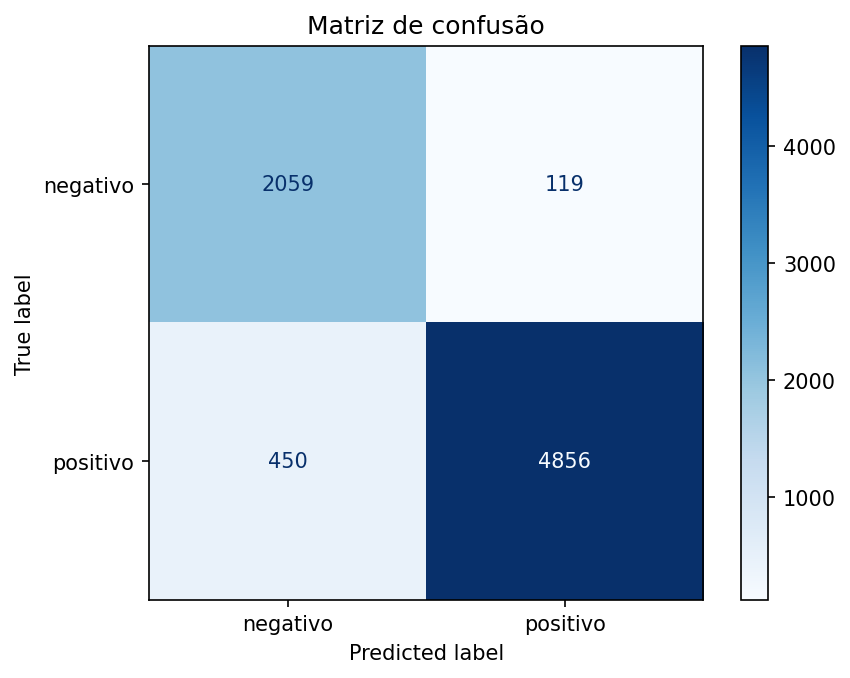
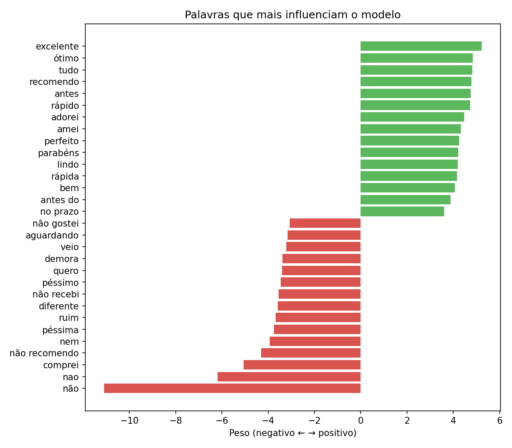

# Análise de Sentimento de Avaliações em Português

Classificador que identifica se uma avaliação de cliente é **positiva** ou **negativa**, usando NLP clássico (TF-IDF + Regressão Logística) sobre o dataset público Olist. O modelo atinge **92% de acurácia** e **95% de recall** na classe negativa (reclamações).

## Por que este projeto?
Entender o que os clientes dizem é essencial para plataformas de delivery e e-commerce: priorizar reclamações, medir satisfação e melhorar a experiência de entrega. Em vez de ler milhares de comentários, um modelo pode sinalizar automaticamente os mais críticos.

## Dados
- [Brazilian E-Commerce Public Dataset by Olist](https://www.kaggle.com/datasets/olistbr/brazilian-ecommerce) (arquivo `olist_order_reviews_dataset.csv`, não incluído neste repositório).
- 99.224 avaliações no total, das quais 40.977 têm comentário escrito.
- Notas 4 e 5 = positivo, notas 1 e 2 = negativo, nota 3 removida.
- Base final: 37.420 avaliações (71% positivas, 29% negativas), ou seja, **desbalanceada**.

## Metodologia
1. **Limpeza do texto:** minúsculas, remoção de pontuação, números e símbolos.
2. **Divisão treino/teste:** 80% / 20%, estratificada para manter a proporção das classes.
3. **TF-IDF** com unigramas e bigramas (para capturar expressões como "não recomendo"), mínimo de 3 ocorrências e até 50 mil termos.
4. **Regressão Logística** com `class_weight="balanced"` para lidar com o desbalanceamento.
5. **Avaliação** com precision, recall, F1 e matriz de confusão, e não só acurácia.

## Resultados (conjunto de teste: 7.484 avaliações)

| Classe | Precision | Recall | F1 |
|---|---|---|---|
| negativo | 0,82 | 0,95 | 0,88 |
| positivo | 0,98 | 0,92 | 0,94 |
| **Acurácia** | | | **0,92** |

Um modelo que sempre previsse "positivo" acertaria apenas ~71%, então o classificador aprendeu padrões reais do texto.



### Palavras que mais influenciam o modelo


## Principais aprendizados
- **Trade-off consciente:** o `class_weight="balanced"` aumentou o recall das reclamações (0,95), que é o mais importante para o negócio, ao custo de uma precision menor (0,82). Na prática, o modelo prefere dar um alarme falso a deixar uma reclamação passar.
- **Prazo é o que mais encanta:** termos como "antes do prazo" e "no prazo" estão entre os mais positivos, e termos como "aguardando" e "demora" entre os mais negativos. A logística domina a percepção do cliente.
- **Os bigramas importam:** "recomendo" é positivo, mas "não recomendo" é negativo. O modelo aprendeu a negação.
- **Limitações:** "não" e "nao" (sem acento) são tratados como palavras diferentes, e termos como "comprei" aparecem como negativos porque os clientes costumam escrever relatos do tipo "comprei e não recebi".

## Como rodar
```bash
pip install -r requirements.txt
# baixe o CSV do Kaggle e coloque na mesma pasta
jupyter notebook analise_sentimento.ipynb
```
Ou abra o notebook direto no Google Colab e envie o CSV.

## Usando o modelo treinado
```python
import joblib
vetorizador, modelo = joblib.load("modelo_sentimento.joblib")
# lembre de aplicar a mesma limpeza de texto do notebook antes de prever
print(modelo.predict(vetorizador.transform(["produto chegou antes do prazo, ótimo"])))
```

## Próximos passos
- Remover acentos na limpeza para unificar "não" e "nao".
- Tratar a classe neutra (3 estrelas).
- Comparar com um modelo em português do Hugging Face (ex.: BERTimbau).
- Publicar uma demo interativa em Streamlit.
